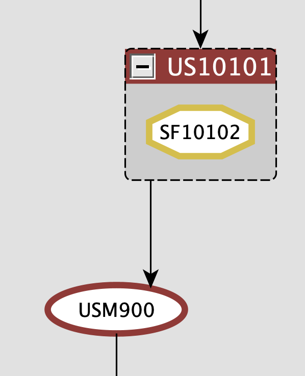
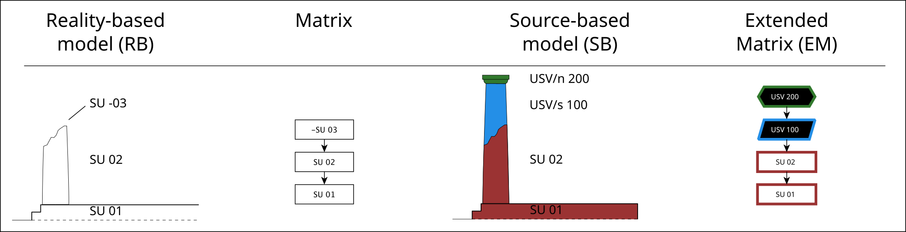
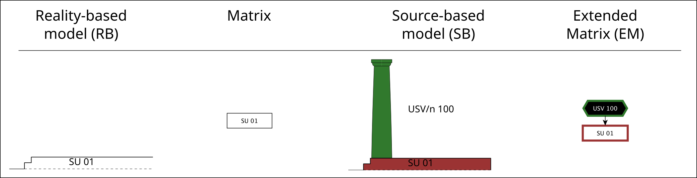
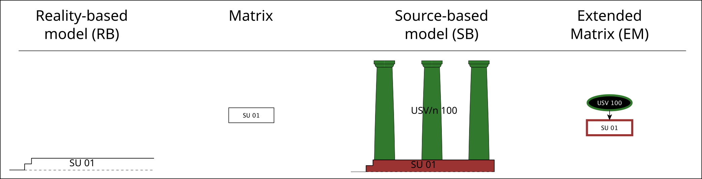
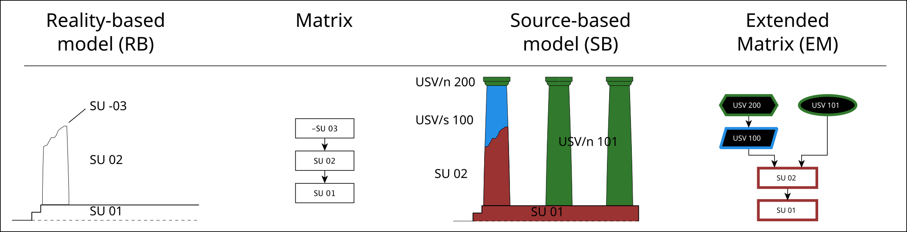
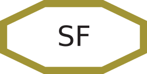
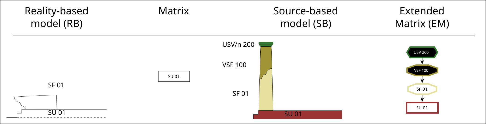
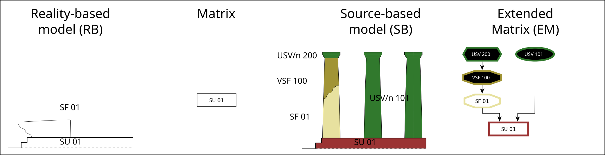
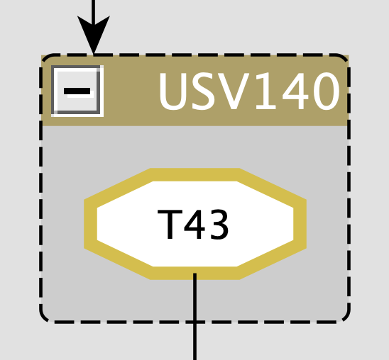
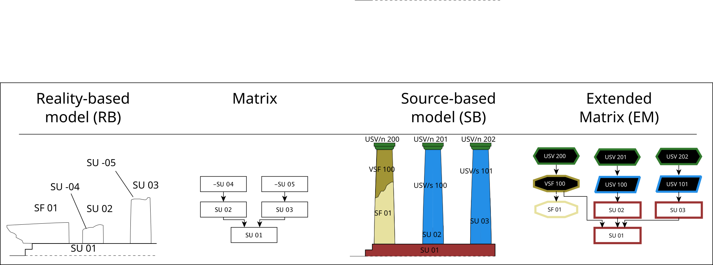

Stratigraphic Nodes
===================

.. _stratigraphicunits:

General background on stratigraphic units (``StratigraphicNode``)
-----------------------------------------------------------------

A stratigraphic unit in some academic scholarships is also known as locus or context. It indicates the result of an action that occurred at a specific moment in time. The result (the construction of a wall, the destruction of a roof, is the silt deposited on top of structures following a flood, the chemical change of surfaces due to a fire) in turn have a life span that ends with the moment it is defunctionalized (destroyed, abandoned, buried). It has a spatio-temporal nature: temporal persistence of a geometry in a given point in space. When the position change, the US will change its nature.

.. tip:: Stratigraphic Units as Storytelling Tools
   
   Think of stratigraphic units as a specialized alphabet for telling the story of a place through time. Just as a writer uses words to craft a narrative, archaeologists and heritage specialists use stratigraphic units to document the biography of a site, piece by piece:

   - Each wall, window, column base, and architectural element is a character in the story
   - Every destruction event (collapse, fire, removal) marks a dramatic turning point
   - Each reconstruction or restoration represents a new chapter
   - Additional elements (lanterns, furniture, decorations) enrich the setting
   - Even historical figures who inhabited the space can be part of the narrative

   Stratigraphic units are remarkably versatile - they can express both tangible and intangible concepts. As you read through the following node types, think of them as letters in your storytelling alphabet. Each node represents a moment in time that created a result, whether physical (like a new wall) or conceptual (like a change in function).

   By combining these "letters" into "words" and "sentences," you can document everything from major architectural transformations to subtle changes in how spaces were used and perceived through time. This makes stratigraphy not just a technical tool, but a powerful narrative device for understanding and communicating the complete life story of a cultural heritage site.

.. note::
  More details about the stratigraphic approach can be found  `here <stratigraphic_approach.html>`_

Stratigraphic units can be classified into main categories:
-----------------------------------------------------------

1. Physical Stratigraphic Units
-------------------------------

These are tangible units that either still exist or have left clear stratigraphic evidence. They can be directly observed, measured, and analyzed in the field. Physical stratigraphic units include existing walls, floors, deposits, or archaeological remains that have been documented through proper stratigraphic methods.

.. _usnode:

1.1. SU - Stratigraphic Unit (``StratigraphicUnit``)
~~~~~~~~~~~~~~~~~~~~~~~~~~~~

A Stratigraphic Unit indicates the result of an action that occurred at a specific moment in time. The SU defines objects found still *in situ* (and noted using the techniques of stratigraphic reading). These are tangible units that either still exist or have left clear stratigraphic evidence. They can be directly observed, measured, and analyzed in the field. Physical stratigraphic units include existing walls, floors, deposits, or archaeological remains that have been documented through proper stratigraphic methods.

SU as Container
^^^^^^^^^^^^^^^

A Stratigraphic Unit can also act as a **container** for Special Finds (SF), Virtual Special Finds (VSF) or Repositioned Special Finds (RSF). This represents the physical containment of elements within a stratigraphic unit -- for example, a reused capital (:ref:`RSF <rsfnode>`) embedded inside a wall (SU).

In the yEd GraphML editor, this is represented by drawing the SU as a **group node** with a dark red background (``#9B3333``) and placing the contained elements inside it. On import, each contained element receives an ``is_part_of`` edge pointing to the SU container. The SU retains all its normal stratigraphic relationships.

   A Stratigraphic Unit (US10101) acting as a container for a Special Find (SF10102). In the GraphML, the SF is nested inside the US group node.

.. seealso::
   :ref:`ispartof` for details on the ``is_part_of`` connector.

.. _serusnode:

1.2. serSU - Serial Stratigraphic Unit (``SeriesOfStratigraphicUnit``)
~~~~~~~~~~~~~~~~~~~~~~~~~~~~~~~~~~~~~~~~~~~~~~~~~~~~~~~~~~~~~~~~~~~~~

A Serial Stratigraphic Unit is employed when it is more practical and efficient to use a single unit to represent multiple serial elements of the same type. This approach is particularly useful for documenting architectural features such as a sequence of capitals, a series of column bases, a set of roof beams, or similar repetitive elements.

This type of serial documentation is specifically used when the elements in the series are geometrically discontinuous - meaning they do not physically touch each other. Examples include multiple wall segments that are spatially separated, freestanding column bases, or other architectural elements that share similar characteristics but are not physically connected.
The flexibility of this system allows for individual elements to be removed from the series and documented separately at any time, should they present unique characteristics or require detailed individual documentation. This might occur when an element shows distinctive decorative features, exhibits unusual wear patterns, or presents specific conservation issues that warrant individual attention.

.. _serusdnode:

2. USD - Documentary Stratigraphic Units (``DocumentaryStratigraphicUnit``)
---------------------------------------------------------------------------

These units are identified through indirect documentation, such as historical records, geophysical surveys, and other analytical techniques. Their existence is substantiated by methods including geophysics, thermography, remote sensing, and by reliable historical sources such as photographs, paintings, artistic representations, written descriptions, maps, plans, and oral histories. Although not physically present, these units can be confidently positioned within the stratigraphic sequence based on documentary evidence. This category also encompasses repositioned elements (anastylosis) when their original placement is verified through historical documentation.

It connects to these properties:
~~~~~~~~~~~~~~~~~~~~~~~~~~~~~~~~

- existence
- geometry
- placement
- material
- color
- etc..

USD as Container
^^^^^^^^^^^^^^^^

Like the SU, a Documentary Stratigraphic Unit can act as a **container** for Special Finds. This represents a documentary context that includes specific elements -- for example, a documentary unit identified from archival sources that is known to have contained a particular artifact.

In yEd, this is represented as a **group node** with an orange background (``#D86400``). On import, contained elements receive ``is_part_of`` edges pointing to the USD container.

.. seealso::
   :ref:`ispartof` for details on the ``is_part_of`` connector.

2.1. serUSD - Serial Documentary Stratigraphic Unit (``SeriesOfDocumentaryStratigraphicUnit``)
~~~~~~~~~~~~~~~~~~~~~~~~~~~~~~~~~~~~~~~~~~~~~~~~~~~~~~~~~~~~~~~~~~~~~~~~~~~~~~~~~~~~~~~~~~~~~~

A Serial Documentary Stratigraphic Unit is employed when it is more practical and efficient to use a single unit to represent multiple serial documentary elements of the same type. This approach is particularly useful for documenting groups of documentary stratigraphic units that share similar characteristics and are identified through the same type of indirect documentation (historical records, geophysical surveys, etc.).

Like the serSU, this type of serial documentation is used when the elements in the series are geometrically discontinuous. Individual elements can be removed from the series and documented separately at any time, should they present unique characteristics or require detailed individual documentation.

.. _usd:

3. Virtual Stratigraphic Units (USV)
------------------------------------

These represent elements that no longer exist and must be reconstructed. Their existence is inferred through presence of physical gaps on archaeological evidence, analysis of surrounding structures, architectural necessity, and comparative studies. Virtual units are essential for understanding the complete stratigraphic sequence, even though they cannot be directly observed. Their reconstruction requires careful analysis and interpretation of available evidence. 

They are divided into:

.. _usvnodes:

3.1 USV/s - Structural Stratigraphic Unit (``StructuralVirtualStratigraphicUnit``)
~~~~~~~~~~~~~~~~~~~~~~~~~~~~~~~~~~~~~~~~~

Structural Virtual Stratigraphic Unit, a reconstruction hypothesis based on an in situ fragmented SU. It acts as a restoration of a -SU, making its presence "physically proven."

  
  Example: On top of a podium SU01 there is a SU02 (in situ), fragmented due to a -SU03 (destruction of the upper part of the column). A USV/s 100 hypothetical reconstruction is provisioned in order to restore the action of destruction -SU03.

3.2 USV/n - Non-Structural Stratigraphic unit (``NonStructuralVirtualStratigraphicUnit``)
~~~~~~~~~~~~~~~~~~~~~~~~~~~~~~~~~~~~~~~~~~~~~~~~~~~~~~~~~~~~~~~~~~~~~~~~~~~~~~~~~~~~~~~

Non-structural Virtual Stratigraphic Unit, a reconstruction hypothesis based on "sources" such as comparisons or general rules. It is not connected to a -SU and, as a result, is not "physically proven."

  Example: There are only the remains of a podium SU01. A USV/n 100 hypothetical reconstruction is provisioned (without physical destruction signs that prove the presence of a column).

.. _usvseries:

3.3 serUSVn - Serial NonStructural Virtual Stratigraphic Unit (``SeriesOfNonStructuralVirtualStratigraphicUnit``)
~~~~~~~~~~~~~~~~~~~~~~~~~~~~~~~~~~~~~~~~~~~~~~~~~~

A series of USVn objects, like a colonnade or a sequence of acroteria, considered as a whole. This seriation node acts as a proxy for the entire group.

.. note::

   **"Proxy" in two senses — do not confuse them.** Here the word is used
   informally: a seriation node *stands for* a group of objects. The other sense
   — the 3D *proxy* of a stratigraphic unit, the segmented volume — is, since
   EM 1.6, a **property** of that unit (the quale ``geometry``) and not a node of
   its own: the geometry attaches to the US as a property, carrying its own
   paradata chain, with the numbers held in a semantic shape. See
   :ref:`geometry`.

  Example: There are only the remains of a podium SU01. A USV/n 100 hypothetical reconstruction series of columns is provisioned (without physical destruction signs that prove the presence of a column). The series node allows to instance several USV/n at once.

  Example: On top of a podium SU01 there is a column SU02 (in situ) fragmented due to a -SU03 (destruction of the upper part of the column). A USV/s 100 hypothetical reconstruction is provisioned in order to restore the destruction’s action -SU03. A series USV/n 101 is provided in order to complete the peristasis of the temple.

4. Special Finds, Virtual Special Finds and Repositioned Special Finds (SF, VSF and RSF):
-----------------------------------------------------------------------------------------

These three categories describe the life of an object that can be told apart from the layers around it — a block, a column drum, a tile, a coin — from the moment it is found to the moment it is put back, physically or virtually.

* The **Special Find (SF)** is the object as it was **found and documented**: movable, found erratic or inside a layer, taken out during the excavation.
* The **Repositioned Special Find (RSF)** is an object **fixed and immovable**, intentionally put back into a stable unit or into a new functional placement.
* The **Virtual Special Find (VSF)** is the object **as it was**: a hypothesis supported by paradata, which holds the fragments or completes what was restored.

The invariant between SF and RSF is **movable / immovable**. Neither the distance travelled nor what we know about the original position decides the category.

.. note:: **How the object lay is an attribute, not a class.**

   Archaeological usage has codified none of these words, so Extended Matrix fixes them here and keeps to them.

   **In situ**: the object lies where it was made to lie.

   **Redeposited**: a process moved it where it was found — dumping, levelling, erosion. A block in secondary deposition lying inside a layer is redeposited.

   **Fallen in position**: a collapse found where it fell — the stones of a vault on the floor beneath it. The position is accidental but measurable, and it documents the collapse.

   In all three cases the object is a **Special Find (SF)**: these are ways of lying, recorded on the find, not kinds of node. In particular a collapse found in position is an SF, never a "repositioned" find.

   **Repositioned** is no longer said of an SF. An object put back *intentionally* and fixed — a spolium in a wall, a column drum set as street furniture, a historical physical anastylosis — is an **RSF** (section 4.3). An object put back *virtually*, in a position argued from evidence, is a **VSF** reconstructed from the SF (section 4.2): every anastylosis we propose is a VSF.

   A find is attached to the unit that holds it with an ``is_part_of`` edge. The unit does not change type — there is no container node type and no "US node group": containment is a relation, and the presence of ``is_part_of`` edges is the only thing that makes a unit a container. A redeposited find gives that unit a *terminus post quem* and nothing further; the chronological statement travels on the epoch edges, never on the containment.

.. _sfnodes:

4.1 SF - Special Find (``SpecialFindNode``)
~~~~~~~~~~~~~~~~~~~~~~~~~~~~~~~~~~~~~~~~~~

A **movable** physical object, found erratic or inside a layer and taken out during the excavation, documented **where it was found**. The definition is positive: the SF is what was observed — its findspot, its way of lying, its colour, material, dimensions — and not "an object whose original position is unknown". Fragmented or intact, in situ, redeposited or fallen in position, it is an SF.

  Example: Consider a collapsed column (SF01) found near a podium (SU01). The SF documents the actual found piece, while its corresponding VSF represents the column as it was, completing the missing parts. This pairing allows clear distinction between the original element (SF) and its reconstruction (VSF).

  Example: There are only the remains of a podium SU01 with a collapsed column SF01 (special find 01). A USV/n 100 series hypothetical reconstruction of the colonnade is provisioned using the SF as a source.

**The SF in an earlier epoch.** The same object can be drawn in more than one epoch (see :ref:`instancechains`). An earlier instance is an **SF** only when the piece we have today can be estimated **equal** to the ancient one — a very good state of preservation. Otherwise the ancient object is a **VSF**. The representation models of an SF and of its VSF are almost always different: the SF is the surveyed piece, the VSF the object as it was.

4.2 Virtual Special Find (``VirtualSpecialFindNode``)
~~~~~~~~~~~~~~~~~~~~~~~~~~~~~~~~~~~~~~~~~~~~~~~~~~~~

A Virtual Special Find (VSF) is the object **as it was**, a hypothesis supported by paradata. It has **two roles**:

(a) **The VSF that holds the fragments.** The SF are part of it (``is_part_of``; in RDF the VSF ``em:reconstructsFrom`` each SF): the column reassembled from its drums, the moulding from its blocks. The VSF is one whole proxy; no boolean is needed.

(b) **The VSF that completes what was restored.** The missing part around the piece that survives: the capital completed around its preserved half, the roof around the tile that was put back.

Two schools of work are both correct, and Extended Matrix records either:

* **restore the block** — the surveyed piece is integrated where it is missing;
* **remodel the ancient version under control** — a new model of the intact object, with a correct topology (splines, clean surfaces) and the surveyed piece as its reference.

In both cases the difference between the piece that survives (SF) and the intact ancient one (VSF) is obtained by a **boolean** operation: the VSF minus the SF is the integration, the VSF alone the object as it was.

Like other virtual stratigraphic units (VSU/s), a VSF inherits specific physical properties from its corresponding SF, such as material characteristics, certain dimensions, decorative features, and construction techniques. This inheritance of properties ensures that the reconstruction remains coherent with the original element's characteristics.

An **anastylosis** — putting a find back where it stood — is always a VSF, a whole block put back virtually included (a VSF with one member).

VSF as Container (Group Node)
^^^^^^^^^^^^^^^^^^^^^^^^^^^^^

A Virtual Special Find can also act as a **container** for Special Finds. This represents the part--whole relationship where fragments (SF) belong to a reconstructed whole (VSF).

For example: fragments of tiles (SF) that belong to a reconstructed roof (VSF), or individual moulding elements (SF) that compose a complete architectural moulding (VSF). In these cases the relationship is **mereological** (``is_part_of``), not stratigraphic.

In the yEd GraphML editor, this is represented by drawing the VSF as a **group node** with a gold background (``#B19F61``) and placing the SF nodes inside it. On import, each contained SF receives an ``is_part_of`` edge pointing to the VSF container.

   A Virtual Special Find (USV140) acting as a container for a Special Find (T43). The moulding base (T43) is part of the complete moulding (USV140).

The VSF container maintains all its normal stratigraphic relationships (epoch connections, temporal edges with other units, etc.) in addition to the containment relationships with its parts.

.. seealso::
   :ref:`ispartof` for details on the ``is_part_of`` connector.

.. _servsfnode:

4.2.1 serVSF - Serial Virtual Special Find (``SeriesOfVirtualSpecialFindUnit``)
~~~~~~~~~~~~~~~~~~~~~~~~~~~~~~~~~~~~~~~~~~~~~~~~~~~~~~~~~~~~~~~~~~~~~~~~~~~~~~~~

A series of Virtual Special Finds is the **repetition of one and the same object**. Like the other series (serSU, serUSD, serUSV/n, serUSV/s), the series is itself a unit.

*Example*: a broken tile found in the collapse (SF) is completed with a VSF; the roof is then covered with that same tile, instanced over its whole surface with a **serVSF**. The repaired tile (the VSF) is part of the series (``is_part_of``); the series says "this, repeated", and its paradata say where and how many.

.. warning::
   A serVSF is **not** for pieces that are all different. The drums of a column that tapers are each a VSF of their own (or an SF), held by the VSF of the column: the discriminant is the identity of form, not the number of pieces.

In yEd a serVSF is drawn as an **ellipse** (the shape of every series) with the border of the VSF (``#B19F61``).

.. _rsfnode:

4.3 RSF - Repositioned Special Find (``ReusedSpecialFindNode``)
~~~~~~~~~~~~~~~~~~~~~~~~~~~~~~~~~~~~~~~~~~~~~~~~~~~~~~~~~~~~~~~

.. image:: img/2D/RSF.png
  :width: 128px
  :align: left

A **Repositioned Special Find (RSF)** is a physical object, **fixed and immovable**, that has been **intentionally** put back:

- into a **stable unit** — a wall, a pavement: the typical *spolia* case, an inscription cemented into the masonry of a later church;
- or into a **new functional placement** — a column drum set in a square as street furniture.

A historical **physical anastylosis** (the blocks of a temple put back on site by a restoration of the past) is an RSF too. Reuse, the *spolia*, is one case within this definition, not the definition itself.

The defining property is **immobility**. Having travelled is not the criterion: a redeposited block lying in a layer has moved just as far, and a collapse fallen in position lies in a measurable place too, but nobody put them there and they can be lifted: they are SF.

.. note::
   The node keeps its historical identifiers — the class ``ReusedSpecialFind`` and the
   ontology URI ``em:ReusedSpecialFind`` — so that every file and every triple already
   written still resolves. What changed is its label and its definition.

Distinction from Special Find (SF)
^^^^^^^^^^^^^^^^^^^^^^^^^^^^^^^^^^

The boundary between SF and RSF is *physical mobility*, not curatorial
status:

- An architectural block in a museum exhibition or in a storage
  facility — even if it once stood in a different position — is still
  a **Special Find (SF)**. It is movable, can be transported for a
  temporary exhibition, can be re-displayed elsewhere. The same applies
  to objects merely resting on the archaeological site, and to a
  collapse found where it fell.

- An ancient inscription cemented into the masonry of a later building,
  a frieze fragment embedded as filler in a Roman wall, a column drum
  re-used as a threshold and locked into place, a drum fixed in a square
  as a bollard — these are **Repositioned Special Finds (RSF)**. Their
  immobility is *structural*: removing them means destroying or
  dismantling what holds them.

Container relationship
^^^^^^^^^^^^^^^^^^^^^^

An RSF put back into a stable unit belongs to that unit as a
**container** — typically the later wall or masonry that physically
incorporates it. The relationship is expressed via the
standard ``is_part_of`` connector, exactly like an SF inside an SU
container:

- **container SU** → contains → **RSF**

The container SU may itself belong to any epoch and any reconstructive
status; the RSF carries its own dating and provenance, independent
from the host.

.. seealso::
   :ref:`ispartof` for details on the ``is_part_of`` connector, and
   the *SU as Container* paragraph in section 1.1 for the
   group-node rendering convention.

Visual representation
^^^^^^^^^^^^^^^^^^^^^

In yEd the RSF is rendered as an **octagon with a red border**
(``#9B3333``) and a white fill — visually distinct from SF (also
octagon, but with the SF gold border ``#AF8208``) and from VSF (gold
border ``#70581E``). The red border signals that the object has been
put back and fixed, and makes it immediately readable in the matrix.

Archaeological examples
^^^^^^^^^^^^^^^^^^^^^^^

- An ancient inscription bearing a dedication, originally part of a
  Roman temple, cemented into the wall of a medieval church built on
  the temple's ruins.
- A column capital re-used as the base of a sundial in a later
  courtyard.
- A frieze fragment from a destroyed building, embedded as filler
  during the construction of a Byzantine fortification wall.
- A column drum set upright in a modern square as street furniture.
- The blocks of a temple front put back on site by a restoration of the
  early twentieth century.

In each case the same physical object is recorded as an RSF for the
later context (where it is now immobile); if its earlier life is
documented, the RSF can carry additional links back to its original
context as paradata.

Cumulative example of different USV nodes used together
~~~~~~~~~~~~~~~~~~~~~~~~~~~~~~~~~~~~~~~~~~~~~~~~~~~~~~~

  
  USV/s and USV/n are used together. Different -SU allow to propose different USV/s.

5. Transformation Stratigraphic Unit (``TransformationStratigraphicUnit``):
--------------------------------------------------------

These units represent the record of chemical, physical, or biological changes that have occurred over time on a specific surface or material. TSUs allow for the documentation and visualization of not only the current state of preservation but also the chronological sequence of transformative processes within a historic structure. This provides a dynamic perspective that captures all transformations affecting stratigraphic objects.
By mapping these transformations, it becomes possible to analyze the life cycle of historic structures in greater detail, offering insights that support the planning of conservation and restoration strategies.

Typologies of Transformation Stratigraphic Units
~~~~~~~~~~~~~~~~~~~~~~~~~~~~~~~~~~~~~~~~~~~~~~~~~~~~~~~

According to the international standards for identifying and classifying surface degradation pathologies [`ICOMOS-ISCS Glossary of Stone Terms (PDF) <http://openarchive.icomos.org/434/1/Monuments_and_Sites_15_ISCS_Glossary_Stone.pdf>`_
], four primary types of transformations have been identified. These typologies are grouped based on the type of modification they produce on the surface, following the principles of stratigraphy:

- **Colour Change**
Refers to alterations in the color of a surface due to chemical, biological, or environmental factors.

- **Negative/Subtractive Transformation**
Includes processes like detachment or material loss, where portions of the surface are removed due to factors such as erosion, spalling, or mechanical damage.

- **Positive/Additive Transformation**
Encompasses processes where material is added to the surface, such as deposits of dust, salts, or bio-colonization like moss and lichens.

- **Translational Transformation**
Includes deformations or displacements such as cracks, shifts, or warping of the surface, which may result from structural movement, thermal expansion, or other stress factors.

See :ref:`continuity_node` in the Auxiliary Stratigraphic Nodes section for the temporal semantics that govern how real and virtual units persist across epochs.

